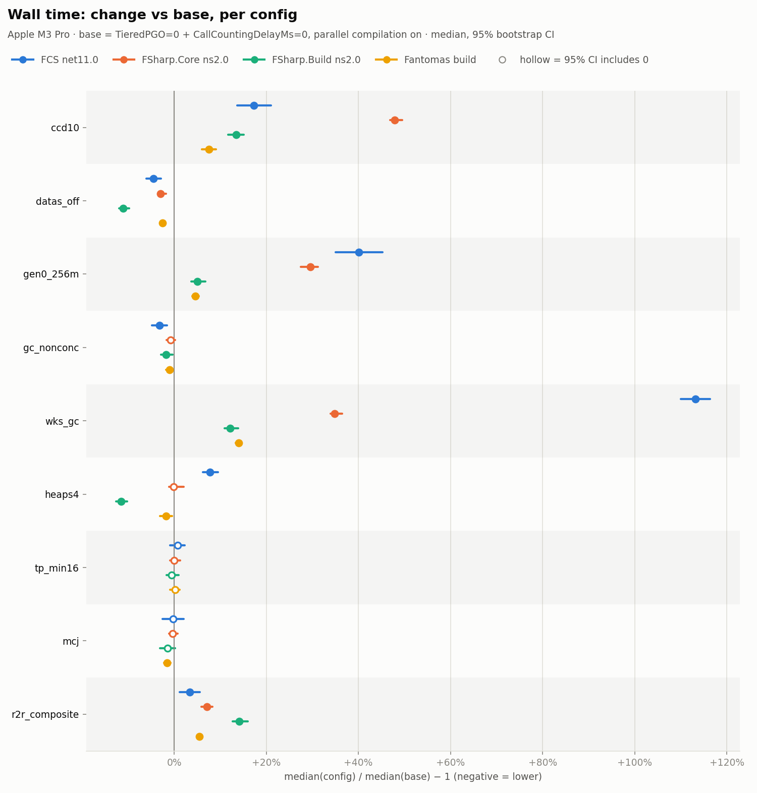
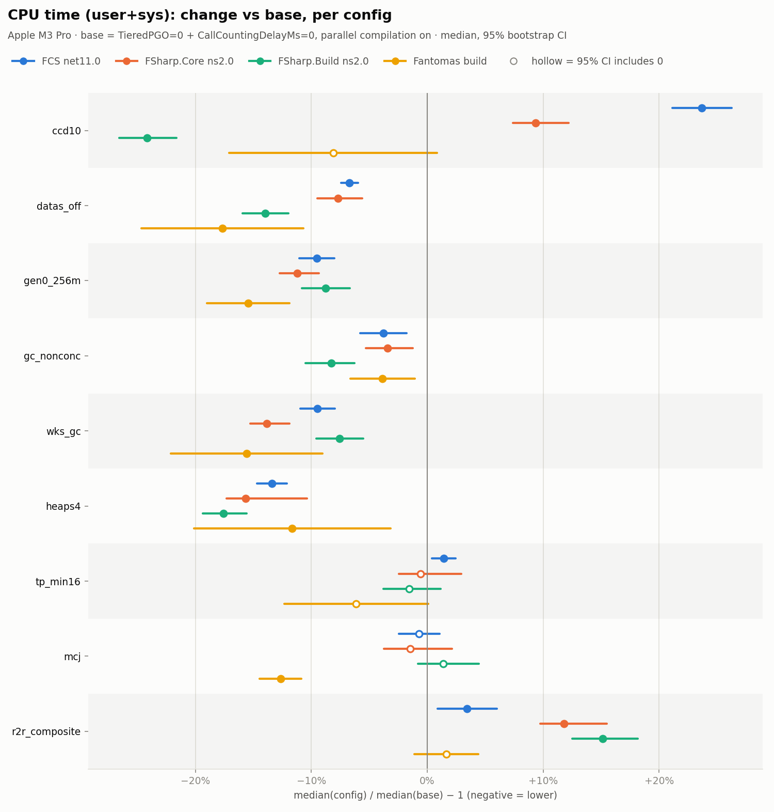

# fsc runtime knobs on top of the JIT flags

_Generated 2026-10-17 19:21 BST by `scripts/report3.py` (harness commit `2b93784`). Interactive version: `reports/phase3/report.html`. All numbers: `reports/phase3/data/summary.json`._

## Summary (preliminary: quick pass)

These numbers come from the quick pass: 2 runs per config for FCS and Fantomas, 3 for FSharp.Core, 10 for FSharp.Build. The full pass (5 / 8 / 20 / 5 runs) replaces them when it finishes. Every change is relative to **base**: both JIT flags set and parallel compilation on.

### What helped

- **DATAS off** (`DOTNET_GCDynamicAdaptationMode=0`) is the only setting that is faster on every target, with lower CPU everywhere:
  - wall: FCS −4.5%, FSharp.Core −2.5%, FSharp.Build −11.3%, Fantomas build −2.6%
  - CPU: −7% to −18%
  - GC pause: −13% (FCS) to −83% (FSharp.Build)
  - Cost: peak memory goes up 37% (FCS) to 135% (FSharp.Core), because the GC no longer shrinks the heap.
- **Non-concurrent GC** (`DOTNET_gcConcurrent=0`): small wins. Wall changes by 0% to −3%, and CPU drops 4% to 9%. GC pause rises about 10%, but it costs less than the background GC it replaces.
- **4 GC heaps** (`DOTNET_GCHeapCount=4`, which also turns DATAS off) helps small compilations (FSharp.Build −11.8%) and saves CPU everywhere (−12% to −18%). It slows FCS by 7.8%, so it isn't a general win.
- **MultiCoreJit** makes no difference to wall time. It does cut Fantomas build CPU by 13%.

### What did not help

- **10 ms call-counting delay** instead of 0: slower on every target (+8% to +49% wall). It lowers CPU only for the small compilation (−25%). A delay of 0 is the right choice.
- **256 MB gen0 budget**: slower (+5% to +40% wall); GC pause goes up 30% to 233%.
- **Workstation GC**: much slower on large compilations (FCS +113% wall).
- **Composite ReadyToRun** of the compiler's own assemblies: slower (+3% to +14% wall). The image does load: without tiering, 39% fewer methods need JIT compilation at all. But more of the precompiled code becomes hot and is recompiled at tier 1, so total JIT work goes up.
- **Thread-pool minimum of 16 threads**: no effect.

### Next

- The full pass adds `datas_nonconc` (DATAS off plus non-concurrent GC). On FSharp.Build it is measured after the other configs instead of interleaved with them.
- These results are from one 11-core Apple M3 Pro. GC settings depend on core count and memory, so they need checking on the Linux x64 machines before recommending any.

## Setup

Hardware:

- **Machine**: MacBook Pro (Mac15,6, model number MRX33B/A)
- **Chip**: Apple M3 Pro
- **CPU cores**: 11 = 5 performance + 6 efficiency (no SMT; 11 logical)
- **Caches**: P-cluster L2 16 MB, E-cluster L2 4 MB, L1d 128 KB (P) / 64 KB (E), cache line 128 B
- **Memory**: 18 GB unified (LPDDR5)
- **Storage**: internal Apple SSD (APFS)
- **Power**: AC Power; Low Power Mode off
- **Thermal**: no thermal or CPU-power throttling warnings recorded (pmset -g therm)

Software:

- **OS**: macOS 27.0.1 (26A434), kernel Darwin 27.0.0
- **Firmware**: 20457.1.29
- **dotnet/fsharp commit**: 99406265c88090c50e575afe8474f0979aa6f815
- **Runtime**: Microsoft.NETCore.App 11.0.0-rc.1.26420.103
- **Fantomas commit**: f734124bc

Method:

1. Reference **base**: fsc from `main`, laid out like the SDK ships it (per-assembly ReadyToRun, Server GC), with `DOTNET_TieredPGO=0` and `DOTNET_TC_CallCountingDelayMs=0`, and parallel compilation on (the default).
2. Each other config changes one thing on top of base (see the table below). `ccd10` sets both JIT settings in `fsc.runtimeconfig.json` instead of env vars (equivalent; it avoids the hex parsing of env values).
3. fsc-level: the captured `FSharp.Compiler.Service.slnx` compilations, replayed in isolation: FCS net11.0, FSharp.Core netstandard2.0 (its first target framework) and FSharp.Build netstandard2.0 (small).
4. Whole build: `dotnet build fantomas.slnx -c Release --no-incremental` on SDK 11 RC1, with each config's fsc (`DotnetFscCompilerPath`) and settings applied to fsc processes only, through a wrapper. MSBuild keeps its defaults.
5. Runs per cell: 2–20, after 1 warm-up. Configs are interleaved in shuffled order every round. The warm-up also records the MultiCoreJit profile that the measured `mcj` runs use.
6. Host monitor and quiet-wait before every run, as in phases 1 and 2; disturbed runs are flagged, not dropped.

| Config | What it is |
|---|---|
| `base` | Reference: DOTNET_TieredPGO=0 + DOTNET_TC_CallCountingDelayMs=0 (env), parallel compilation on |
| `ccd10` | Call-counting delay 10 ms instead of 0. Both JIT settings via fsc.runtimeconfig.json (System.Runtime.TieredPGO=false, CallCountingDelayMs=10), which avoids hex parsing of env values |
| `datas_off` | + DOTNET_GCDynamicAdaptationMode=0 (DATAS off) |
| `gen0_256m` | + DOTNET_GCgen0size=10000000 (hex: 256 MB gen0 budget) |
| `gc_nonconc` | + DOTNET_gcConcurrent=0 (no background GC; the name is case-sensitive on macOS/Linux) |
| `wks_gc` | + DOTNET_gcServer=0 (Workstation GC, concurrent) |
| `heaps4` | + DOTNET_GCHeapCount=4 (Server GC with 4 heaps) |
| `tp_min16` | + runtimeconfig System.Threading.ThreadPool.MinThreads=16 |
| `mcj` | + MultiCoreJit (ProfileOptimization) from a startup hook; one profile per compilation, recorded by the warm-up run |
| `r2r_composite` | + composite ReadyToRun image (crossgen2 --composite --inputbubble) of fsc, FSharp.Compiler.Service, FSharp.Core, FSharp.DependencyManager.Nuget |

## Results





**Wall time**: change vs base (95% CI); bold = CI excludes 0

| Config | FCS net11.0 | FSharp.Core ns2.0 | FSharp.Build ns2.0 | Fantomas build |
|---|---|---|---|---|
| `base` median (s) | 13.76 | 4.46 | 0.89 | 24.42 |
| `ccd10` | **+17.3% (+13.7 to +21.0)** | **+47.9% (+46.9 to +49.5)** | **+13.5% (+11.7 to +15.1)** | **+7.5% (+6.0 to +9.1)** |
| `datas_off` | **-4.5% (-6.0 to -2.9)** | **-2.9% (-3.4 to -1.7)** | **-11.1% (-12.0 to -9.8)** | **-2.6% (-3.0 to -2.2)** |
| `gen0_256m` | **+40.1% (+35.0 to +45.2)** | **+29.6% (+27.5 to +31.2)** | **+5.0% (+3.7 to +6.8)** | **+4.6% (+3.9 to +5.4)** |
| `gc_nonconc` | **-3.2% (-4.9 to -1.5)** | -0.8% (-1.7 to +0.2) | **-1.7% (-2.9 to -0.4)** | **-0.9% (-1.7 to -0.1)** |
| `wks_gc` | **+113.1% (+110.0 to +116.4)** | **+34.8% (+34.0 to +36.5)** | **+12.2% (+11.0 to +13.9)** | **+14.0% (+13.4 to +14.7)** |
| `heaps4` | **+7.8% (+6.2 to +9.5)** | -0.1% (-1.1 to +2.0) | **-11.5% (-12.6 to -10.2)** | **-1.8% (-3.1 to -0.5)** |
| `tp_min16` | +0.7% (-0.9 to +2.3) | -0.0% (-0.9 to +1.3) | -0.6% (-1.6 to +1.0) | +0.2% (-0.9 to +1.2) |
| `mcj` | -0.3% (-2.5 to +2.0) | -0.4% (-1.1 to +0.8) | -1.4% (-3.1 to +0.2) | **-1.5% (-2.2 to -0.8)** |
| `r2r_composite` | **+3.3% (+1.2 to +5.5)** | **+7.1% (+5.9 to +8.3)** | **+14.1% (+12.7 to +16.0)** | **+5.5% (+5.1 to +6.0)** |

**CPU time (user+sys)**: change vs base (95% CI); bold = CI excludes 0

| Config | FCS net11.0 | FSharp.Core ns2.0 | FSharp.Build ns2.0 | Fantomas build |
|---|---|---|---|---|
| `base` median (s) | 71.61 | 12.23 | 2.33 | 110.21 |
| `ccd10` | **+23.7% (+21.1 to +26.3)** | **+9.4% (+7.4 to +12.2)** | **-24.1% (-26.6 to -21.6)** | -8.1% (-17.1 to +0.9) |
| `datas_off` | **-6.7% (-7.4 to -5.9)** | **-7.7% (-9.5 to -5.6)** | **-14.0% (-15.9 to -12.0)** | **-17.7% (-24.6 to -10.7)** |
| `gen0_256m` | **-9.5% (-11.0 to -8.0)** | **-11.2% (-12.7 to -9.3)** | **-8.8% (-10.8 to -6.7)** | **-15.5% (-19.0 to -11.9)** |
| `gc_nonconc` | **-3.8% (-5.8 to -1.8)** | **-3.4% (-5.3 to -1.2)** | **-8.3% (-10.5 to -6.3)** | **-3.9% (-6.6 to -1.1)** |
| `wks_gc` | **-9.5% (-10.9 to -8.0)** | **-13.8% (-15.3 to -11.9)** | **-7.6% (-9.6 to -5.5)** | **-15.6% (-22.1 to -9.0)** |
| `heaps4` | **-13.4% (-14.7 to -12.1)** | **-15.7% (-17.3 to -10.4)** | **-17.6% (-19.4 to -15.6)** | **-11.6% (-20.1 to -3.2)** |
| `tp_min16` | **+1.4% (+0.4 to +2.5)** | -0.6% (-2.4 to +3.0) | -1.6% (-3.8 to +1.1) | -6.1% (-12.3 to +0.1) |
| `mcj` | -0.7% (-2.4 to +1.1) | -1.4% (-3.8 to +2.1) | +1.4% (-0.8 to +4.4) | **-12.7% (-14.5 to -10.8)** |
| `r2r_composite` | **+3.4% (+0.9 to +6.0)** | **+11.8% (+9.7 to +15.5)** | **+15.1% (+12.5 to +18.2)** | +1.6% (-1.1 to +4.4) |

**GC pause time (total)**: change vs base (95% CI); bold = CI excludes 0

| Config | FCS net11.0 | FSharp.Core ns2.0 | FSharp.Build ns2.0 |
|---|---|---|---|
| `base` median (ms) | 3245 | 515 | 90 |
| `ccd10` | +4.6% (-1.3 to +10.6) | -0.5% (-4.4 to +1.2) | **-6.5% (-9.3 to -5.1)** |
| `datas_off` | **-12.6% (-14.4 to -10.8)** | **-40.2% (-42.7 to -34.0)** | **-82.6% (-82.9 to -82.2)** |
| `gen0_256m` | **+167.1% (+148.2 to +186.3)** | **+254.1% (+238.1 to +261.2)** | **+31.3% (+23.4 to +33.4)** |
| `gc_nonconc` | **+8.8% (+7.1 to +10.5)** | **+13.4% (+8.5 to +16.2)** | **+15.6% (+13.7 to +17.2)** |
| `wks_gc` | **+425.2% (+419.2 to +431.3)** | **+301.3% (+290.1 to +306.7)** | **+140.7% (+137.2 to +144.4)** |
| `heaps4` | **+42.6% (+41.3 to +44.0)** | **+10.4% (+3.6 to +18.2)** | **-87.6% (-87.9 to -87.3)** |
| `tp_min16` | -0.2% (-1.3 to +0.8) | +2.6% (-4.0 to +4.8) | -0.3% (-2.4 to +2.0) |
| `mcj` | **-1.4% (-2.5 to -0.3)** | -3.6% (-7.3 to +0.8) | **-5.6% (-10.5 to -3.7)** |
| `r2r_composite` | -2.4% (-5.4 to +0.8) | **-4.5% (-8.1 to -0.7)** | **-7.4% (-9.8 to -3.6)** |

**JIT time (all threads)**: change vs base (95% CI); bold = CI excludes 0

| Config | FCS net11.0 | FSharp.Core ns2.0 | FSharp.Build ns2.0 |
|---|---|---|---|
| `base` median (ms) | 5651 | 3181 | 994 |
| `ccd10` | **-6.7% (-10.8 to -2.4)** | **-42.7% (-44.3 to -42.1)** | **-81.4% (-81.7 to -81.0)** |
| `datas_off` | **-8.3% (-11.8 to -4.7)** | **-9.6% (-11.0 to -8.3)** | **-10.5% (-11.6 to -9.5)** |
| `gen0_256m` | **+49.5% (+40.1 to +59.3)** | **+18.7% (+16.0 to +20.6)** | **+4.9% (+3.8 to +6.3)** |
| `gc_nonconc` | -2.8% (-6.0 to +0.5) | +0.1% (-1.2 to +0.8) | **-2.3% (-3.3 to -1.0)** |
| `wks_gc` | **+92.5% (+88.4 to +96.7)** | **+23.8% (+21.0 to +24.7)** | **+11.5% (+10.3 to +12.5)** |
| `heaps4` | -2.3% (-7.9 to +3.5) | +0.8% (-1.2 to +3.5) | **-10.7% (-11.8 to -9.8)** |
| `tp_min16` | +2.5% (-0.8 to +5.9) | +1.2% (-1.3 to +1.8) | -0.8% (-2.2 to +0.6) |
| `mcj` | -1.9% (-4.7 to +1.0) | -0.5% (-1.6 to +1.1) | **-1.1% (-2.2 to -0.2)** |
| `r2r_composite` | **+3.2% (+0.8 to +5.6)** | **+3.5% (+1.8 to +5.4)** | **+7.5% (+6.1 to +8.8)** |

## Did each setting take effect?

Read inside each fsc process at exit by the stats hook (first measured run of each config).

| Config | Server GC | Concurrent GC | GC heaps | DATAS | gen0size env | TP min workers | TieredPGO | Call-counting delay | MultiCoreJit hook | Composite R2R |
|---|---|---|---|---|---|---|---|---|---|---|
| `base` | True | True | 11 | on | – | 11 | env 0 | env 0 | – | – |
| `ccd10` | True | True | 11 | on | – | 11 | runtimeconfig false | runtimeconfig 10 | – | – |
| `datas_off` | True | True | 11 | off | – | 11 | env 0 | env 0 | – | – |
| `gen0_256m` | True | True | 11 | on | 10000000 | 11 | env 0 | env 0 | – | – |
| `gc_nonconc` | True | False | 11 | on | – | 11 | env 0 | env 0 | – | – |
| `wks_gc` | False | True | 1 | on | – | 11 | env 0 | env 0 | – | – |
| `heaps4` | True | True | 4 | off | – | 11 | env 0 | env 0 | – | – |
| `tp_min16` | True | True | 11 | on | – | 16 | env 0 | env 0 | – | – |
| `mcj` | True | True | 11 | on | – | 11 | env 0 | env 0 | yes | – |
| `r2r_composite` | True | True | 11 | on | – | 11 | env 0 | env 0 | – | yes |

## Measurement quality

- **FCS net11.0**: 0 of 20 runs flagged.
- **FSharp.Core ns2.0**: 0 of 62 runs flagged.
- **FSharp.Build ns2.0**: 5 of 200 runs flagged.
- **Fantomas build**: 0 of 20 runs flagged.
- Flag rule, fsc runs: foreign CPU > 1.0 core avg during the run, or host busy >= 1.0 core right before it, or any swapout, or > 5000 page compressions.
- Flag rule, whole builds: host busy >= 1.0 core right before the build, or any swapout (build CPU is system-wide, so foreign CPU is not separable).

## Reproduce

```
scripts/run_phase3.sh all      # prep (hooks, layouts), fsc runs, Fantomas builds
.venv/bin/python scripts/report3.py
```
