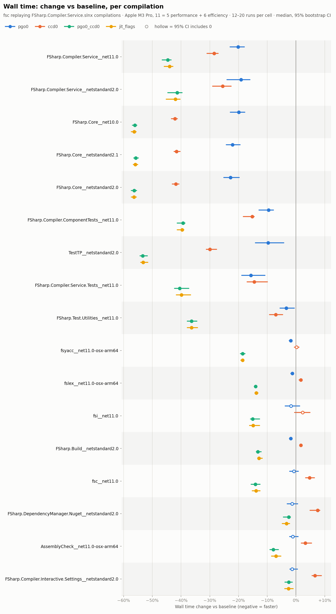
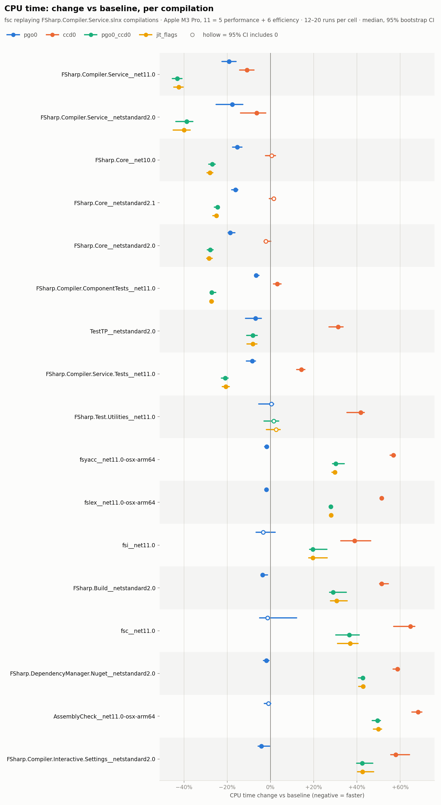
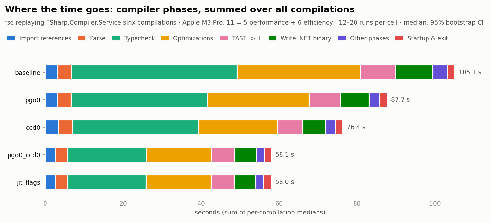
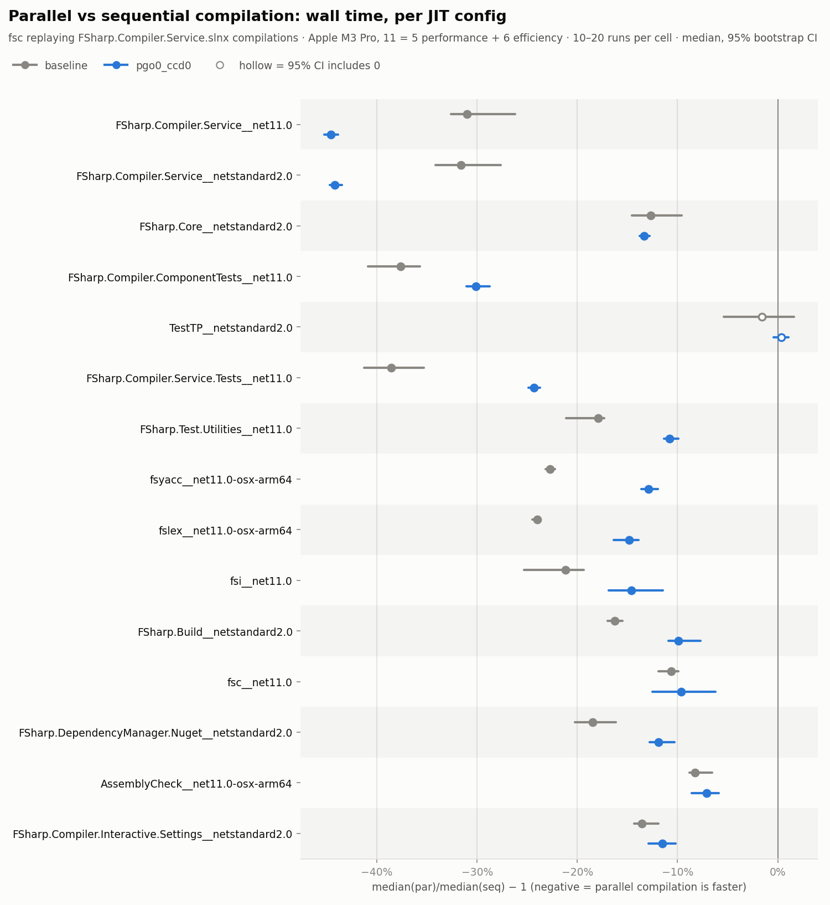
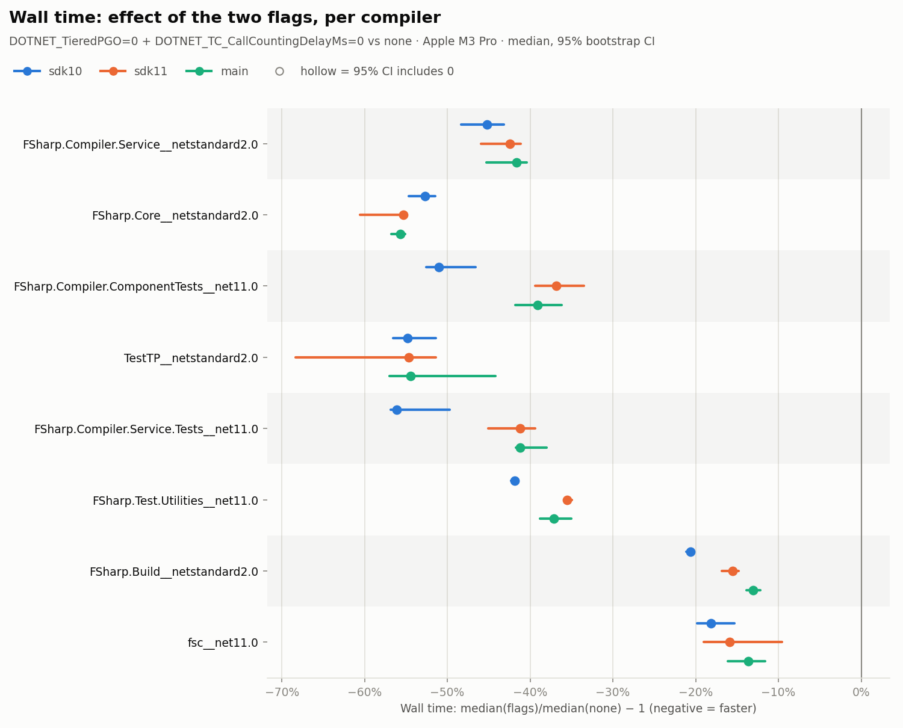
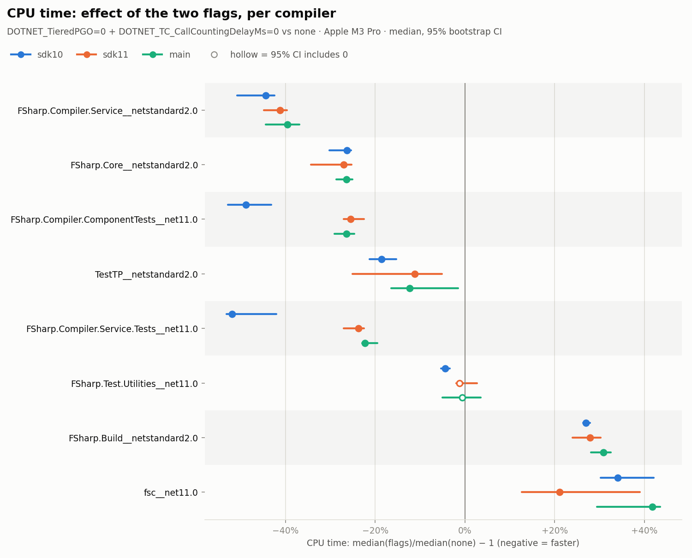

# F# compiler (fsc) benchmark: JIT flags and parallel compilation

_Generated 2026-10-17 18:16 BST by `scripts/report.py` (harness commit `931a2fe`). Interactive version with every metric: `reports/report.html`. All numbers: `reports/data/summary.json`._

## Summary

Tested: `DOTNET_TieredPGO=0` and `DOTNET_TC_CallCountingDelayMs=0` for the fsc process, on all 17 compilations of FSharp.Compiler.Service.slnx, replayed in isolation on an Apple M3 Pro (11 cores, macOS), with fsc laid out like the .NET SDK ships it (ReadyToRun, Server GC). Numbers are changes in the median with a 95% bootstrap CI.

### 1. Both flags together: about 45% less wall time and 33% less CPU

- All 17 compilations together (sum of medians): **105.8 s → 58.3 s wall (−44.9%, CI −45.8% to −44.5%)**, and **CPU −33.0%** (CI −35.2% to −31.6%).
- Each flag alone: `TieredPGO=0` −17.1% wall, `CallCountingDelayMs=0` −27.6% wall. Together they do more than the two alone would multiply to (about −40%).
- Large and medium compilations (5 s to 25 s): **−39% to −56% wall**, with lower CPU (−8% to −43%).
  - FSharp.Compiler.Service net11.0: 24.4 s → 13.5 s (−44.6%), CPU −43.1%.
  - FSharp.Core netstandard2.0: −56.3% wall, CPU −27.9%.
- Small compilations (under about 1.5 s): only −3% to −19% wall, and **CPU goes up 20% to 49%**. In a process this short, recompiling startup code at tier 1 costs more CPU than it saves.
- GC pause time does not change with the flags (within ±1.3%).
- The `jit_flags` branch (the flags set by `Microsoft.FSharp.Targets` instead of by hand) measures the same as setting the env vars (A/A difference +0.0%, CI −0.3% to +0.7%).

### 2. Parallel compilation, with and without the flags

- All compilations together, parallel vs sequential: **−27.7% wall without the flags, −34.4% with them**. CPU goes up 71% without the flags and 36% with them.
- Largest compilation (FSharp.Compiler.Service): the flags make parallel compilation help more: −31% becomes **−45%**. Flags plus parallel compilation take it from 35.1 s to 13.7 s.
- Mid-size and small compilations: parallel compilation helps less with the flags. For example FCS.Tests goes from −39% to −24%. The flags shrink the parallel phases, so the serial parts (startup, writing the binary) are a larger share of what is left.
- For every compilation, flags plus parallel compilation is still the fastest of the four combinations.

### 3. SDK 10 vs SDK 11, and whole builds

- On the compilers as shipped in SDK 10.0.302 and SDK 11 RC1 (no SDK files changed, flags as env vars), all 8 measured compilations together: **SDK 10 −48.6% wall / −41.9% CPU**, **SDK 11 −44.2% wall / −32.4% CPU**.
- Without the flags, SDK 10 and SDK 11 are within about ±10% of each other. With the flags, SDK 10 is 0% to 18% faster than SDK 11 on most compilations.
- With the same `fsc.runtimeconfig.json`, .NET 11 runs about 5 times as many gen0 GCs as .NET 10 on FSharp.Compiler.Service, with a 35% smaller peak heap. Total GC pause is about the same.
- Whole `dotnet build` of Fantomas: **−23% wall** with the flags set on `dotnet build`, on both SDKs. With the flags on fsc processes only: −19%. Build-level CPU changes were not significant.

### 4. Measurement quality and caveats

- Disturbed runs (host monitor): 50 of 1380 in phase 1, 13 of 640 in phase 2. Excluding them does not change the totals (−44.8% instead of −44.9%).
- Instrumentation cost (stats hook and `--times`) is +2% to +3% wall and not significant, in every config alike.
- One machine: 11-core Apple M3 Pro, macOS, .NET 11 RC1. Linux x64 machines with more cores may differ, especially in how much the background tier-1 JIT costs.
- Compilations are replayed one at a time. In a real build several run at once, which is why the whole-build gain is smaller.

## Untested candidates for further gains

None of these were benchmarked in phases 1-2; phase 3 tests several of them (separate report: `reports/phase3/report.html`). Each item gives the evidence from the data above, and how to test it. Scope: SDK 11 / `main`, parallel compilation on, both flags set.

### 1. GC: pauses are 11-24% of wall time, and the flags don't change them

- Evidence (both flags, total pause from `GC.GetTotalPauseDuration`):
  - FSharp.Compiler.Service ns2.0: **2.96 s of 12.4 s (24%)**, 33 GB allocated, 112 gen0 / 47 gen1 / 12 gen2 GCs.
  - ComponentTests: 0.68 s of 3.9 s (17%). FCS.Tests: 0.51 s of 3.2 s (16%). FSharp.Core ns2.0: 0.50 s of 4.6 s (11%).
  - Pause time is the same with and without the flags. As JIT time shrinks, GC becomes a larger share of what remains.
- .NET 10 and .NET 11 behave differently with an identical `fsc.runtimeconfig.json`. For FCS, .NET 11 runs about 5x more gen0 GCs (112 vs 23) with a 35% smaller peak heap (2.7 vs 4.3 GB), but total pause is about the same (~2.9 s). This fits a change in DATAS tuning; not verified.
- Since 5x more collections give the same total pause, pause time is probably dominated by marking and promoting the compiler's long-lived data (typed trees, symbol tables), not by collection count.
- To try:
  - A larger gen0 budget (`DOTNET_GCgen0size`, or `GCGen0MaxBudget`), so fewer GCs promote live data.
  - `DOTNET_GCDynamicAdaptationMode=0` (DATAS off).
  - `DOTNET_GCConcurrent=0`. A batch process gains little from background gen2 GC, which costs CPU.
  - In whole builds: `DOTNET_GCHeapCount` (e.g. 4), or turning off heap affinitization. Several fsc processes with 11 Server GC heaps each run on 11 cores at once. This may be part of why the build-level gain (-23%) is smaller than the per-compilation gain.
  - Longer term: fewer allocations (FCS allocates about 2.6 GB/s). This needs compiler code changes.

### 2. JIT: ship the flags properly, and lower startup JIT cost

- Ship the flags as runtimeconfig properties of fsc and fsi. That means `System.Runtime.TieredPGO: false` and `System.Runtime.TieredCompilation.CallCountingDelayMs: 0` in dotnet/sdk `tool_fsc.csproj`. This scopes them to the compiler. An env var on `dotnet build` also changes MSBuild, which accounted for about 4 of the 23 points at build level.
- Why the default is slow for a compiler (reading of the runtime design, not traced): the 100 ms call-counting delay is extended whenever new tier-0 code is jitted. A compiler keeps jitting new methods for seconds, so hot methods stay at tier 0. For FCS net11.0, `CallCountingDelayMs=0` alone gives about -28% wall and `TieredPGO=0` alone about -20%. Together they give about -44%.
- Tiny compilations (under ~1 s) pay +21-42% CPU with the flags, because startup code is recompiled at tier 1 almost at once. A small non-zero delay (e.g. 10-20 ms) may keep most of the win without that. Untested.
- A lot of code is still jitted despite R2R. Even `fsc.dll` (0.8 s) jits about 2,800 methods in about 180 ms of JIT time. These are probably generic instantiations over FSharp.Core types, closures, and methods R2R rejected. Options:
  - MultiCoreJit in fsc's entry point (`System.Runtime.ProfileOptimization.SetProfileRoot` + `StartProfile`). It records startup methods and pre-jits them on background threads in later runs. Roughly a two-line change.
  - Crossgen2 `--inputbubble` (or a composite image) for FSharp.Compiler.Service + FSharp.Core. This allows cross-assembly inlining and pre-compiled generic instantiations.
  - MIBC profiles for crossgen2 (`--mibc`). The SDK's crossgen step passes neither `-O` nor any profile today.
- NativeAOT would remove JIT entirely, but the compiler's reflection use and FSharp.Core `printf` make it a long-term option at best.

### 3. Parallelism and serial phases

- FCS with both flags averages 5.1 busy cores out of 11 (69 s CPU in 13.5 s wall).
- Phases (`--times`, both flags): Optimizations 4.9 s, Typecheck 3.4 s, **Write .NET Binary 1.8 s**, TAST -> IL 1.7 s, Parse 0.8 s.
- `Write .NET Binary` (13% of wall) is likely single-threaded, and so a clear target. Per-phase CPU wasn't recorded, so which phases are serial is not confirmed.
- FCS ends with about 31 thread-pool threads on 11 cores. That suggests blocking waits on pool threads, which make the pool inject threads. Lower confidence; worth checking in a trace.

### 4. Suggested order

1. Move the flags into fsc's runtimeconfig. The gain is measured and the change is small.
2. Sweep GC settings on FCS and FSharp.Core, both in isolation and in a whole build.
3. Prototype MultiCoreJit in fsc. It mainly helps the many small projects in real codebases.
4. Try crossgen2 `--inputbubble` / composite and MIBC.
5. A compiler server removes most of the JIT cost and part of the GC cost (warm code, reused heap). It is the larger, separate step.

## Setup

Hardware:

- **Machine**: MacBook Pro (Mac15,6, model number MRX33B/A)
- **Chip**: Apple M3 Pro
- **CPU cores**: 11 = 5 performance + 6 efficiency (no SMT; 11 logical)
- **Caches**: P-cluster L2 16 MB, E-cluster L2 4 MB, L1d 128 KB (P) / 64 KB (E), cache line 128 B
- **Memory**: 18 GB unified (LPDDR5)
- **Storage**: internal Apple SSD (APFS)
- **Power**: AC Power; Low Power Mode off
- **Thermal**: no thermal or CPU-power throttling warnings recorded (pmset -g therm)

Software:

- **OS**: macOS 27.0.1 (26A434), kernel Darwin 27.0.0
- **Firmware**: 20457.1.29
- **dotnet/fsharp commit (baseline)**: 99406265c88090c50e575afe8474f0979aa6f815
- **jit_flags branch commit**: 43600ddcb0c33f2fb8267e1302f5440e5189a001 (https://github.com/safesparrow/fsharp/tree/jit_flags)
- **Runtime**: Microsoft.NETCore.App 11.0.0-rc.1.26420.103
- **crossgen2**: 11.0.0-rc.1.26420.103 (same build as the runtime)

Method:

1. Build dotnet/fsharp in Release (`./build.sh -c Release`).
2. Make an SDK-like layout: crossgen2 (ReadyToRun) each assembly the way dotnet/sdk does, and use the SDK's `fsc.runtimeconfig.json` (Server GC).
3. Do one full `dotnet build FSharp.Compiler.Service.slnx -c Release` with an fsc wrapper, to capture every fsc command line (17 compilations, 14 projects).
4. Replay each compilation in isolation (`dotnet fsc.dll @rsp`). Inputs are identical in every config, and outputs go to a scratch dir.
5. For each compilation: 1 warm-up, then 12–20 measured rounds. Every round runs all configs in shuffled order, so drift hits every config equally.
6. Per run, record:
   - wall and CPU time and peak RSS (`wait4`)
   - GC pause, GC count, allocations, JIT time and methods (startup hook: `GC.GetTotalPauseDuration`, `JitInfo`)
   - compiler phases (`--times:<csv>`)
   - host activity (system-wide CPU ticks, paging)
7. Flag a run as host-disturbed if: foreign CPU > 1.0 core avg during the run, or host busy >= 1.0 core right before it, or any swapout, or > 5000 page compressions. Headline totals are shown with and without flagged runs.

Configurations:

| config | what |
|---|---|
| `baseline` | Default runtime settings (what the SDK does today) |
| `pgo0` | DOTNET_TieredPGO=0 |
| `ccd0` | DOTNET_TC_CallCountingDelayMs=0 |
| `pgo0_ccd0` | DOTNET_TieredPGO=0 + DOTNET_TC_CallCountingDelayMs=0 |
| `jit_flags` | Compiler built from branch jit_flags; env exactly as its Microsoft.FSharp.Targets injects (same as pgo0_ccd0) |

## Phase 1: JIT flags (parallel compilation on, as in a normal build)

### Whole solution (sum of per-compilation medians)

| config | wall | CPU | GC pause | JIT time | wall, flagged runs excluded |
|---|---|---|---|---|---|
| `baseline` | 105.8 s | 355.0 s | 10.2 s | 15.5 s | |
| `pgo0` | **-17.1% (-18.6 to -16.1)** | **-15.7% (-18.4 to -13.8)** | +0.1% (-0.7 to +1.0) | **-29.5% (-32.1 to -27.9)** | **-17.1% (-18.5 to -16.1)** |
| `ccd0` | **-27.6% (-28.7 to -26.9)** | -1.6% (-4.7 to +0.2) | +0.0% (-0.9 to +0.9) | **+352.2% (+338.7 to +358.4)** | **-27.6% (-28.5 to -26.8)** |
| `pgo0_ccd0` | **-44.9% (-45.8 to -44.4)** | **-33.0% (-35.0 to -31.7)** | +0.4% (-0.6 to +1.4) | **+154.5% (+147.1 to +158.2)** | **-44.8% (-45.7 to -44.3)** |
| `jit_flags` | **-44.9% (-45.7 to -44.4)** | **-33.2% (-35.3 to -32.1)** | +0.8% (-0.5 to +1.6) | **+154.8% (+146.8 to +158.3)** | **-44.8% (-45.6 to -44.3)** |

Values are the change vs `baseline`, with the 95% CI in parentheses. **Bold** = the CI excludes 0.

Noise floor: `jit_flags` vs `pgo0_ccd0` is the same compiler code with the same env, built twice. Whole-solution wall +0.0% (-0.3 to +0.6), CPU -0.3% (-1.2 to +0.3).

### Wall time per compilation

### CPU time per compilation

### Wall time per compilation

| compilation | baseline median | `pgo0` | `ccd0` | `pgo0_ccd0` | `jit_flags` |
|---|---:|---|---|---|---|
| FSharp.Compiler.Service__net11.0 | 24.36 s ± 1.17 | **-20.2% (-23.0 to -18.0)** | **-28.5% (-31.0 to -27.1)** | **-44.6% (-46.6 to -43.5)** | **-44.0% (-45.9 to -42.8)** |
| FSharp.Compiler.Service__netstandard2.0 | 22.34 s ± 1.27 | **-19.1% (-24.0 to -16.0)** | **-25.6% (-29.1 to -22.5)** | **-41.4% (-44.6 to -39.7)** | **-42.0% (-45.2 to -40.3)** |
| FSharp.Core__net10.0 | 10.74 s ± 0.38 | **-19.9% (-22.9 to -17.8)** | **-42.1% (-43.4 to -41.2)** | **-56.1% (-57.0 to -55.4)** | **-56.3% (-57.3 to -55.6)** |
| FSharp.Core__netstandard2.1 | 10.18 s ± 0.22 | **-22.1% (-24.3 to -19.4)** | **-41.6% (-42.5 to -40.4)** | **-55.8% (-56.5 to -54.8)** | **-56.0% (-56.6 to -55.1)** |
| FSharp.Core__netstandard2.0 | 10.17 s ± 0.26 | **-22.8% (-25.1 to -19.8)** | **-41.9% (-43.1 to -40.8)** | **-56.3% (-57.4 to -55.5)** | **-56.4% (-57.3 to -55.6)** |
| FSharp.Compiler.ComponentTests__net11.0 | 6.48 s ± 0.13 | **-9.5% (-12.9 to -7.9)** | **-15.2% (-18.4 to -14.5)** | **-39.3% (-41.4 to -38.6)** | **-39.6% (-41.4 to -39.0)** |
| TestTP__netstandard2.0 | 6.02 s ± 0.22 | **-9.7% (-14.1 to -4.3)** | **-30.0% (-31.2 to -27.6)** | **-53.4% (-54.3 to -51.7)** | **-53.2% (-54.0 to -51.6)** |
| FSharp.Compiler.Service.Tests__net11.0 | 5.34 s ± 0.31 | **-15.7% (-18.9 to -10.8)** | **-14.5% (-17.0 to -9.9)** | **-40.5% (-42.3 to -37.3)** | **-39.9% (-41.7 to -36.7)** |
| FSharp.Test.Utilities__net11.0 | 3.10 s ± 0.08 | **-3.4% (-5.5 to -0.6)** | **-7.1% (-9.3 to -4.6)** | **-36.4% (-37.9 to -34.5)** | **-36.4% (-37.8 to -34.3)** |
| fsyacc__net11.0-osx-arm64 | 1.36 s ± 0.01 | **-1.8% (-2.4 to -1.3)** | +0.2% (-0.6 to +1.0) | **-18.6% (-19.4 to -17.8)** | **-18.6% (-19.2 to -18.2)** |
| fslex__net11.0-osx-arm64 | 1.10 s ± 0.01 | **-1.3% (-1.8 to -0.9)** | **+1.7% (+1.1 to +2.2)** | **-14.0% (-14.6 to -13.8)** | **-13.9% (-14.3 to -13.2)** |
| fsi__net11.0 | 1.06 s ± 0.73 | -1.7% (-3.8 to +1.3) | +2.3% (-0.5 to +4.9) | **-15.1% (-15.9 to -12.6)** | **-14.9% (-16.2 to -12.7)** |
| FSharp.Build__netstandard2.0 | 1.03 s ± 0.01 | **-1.8% (-2.3 to -1.3)** | **+1.7% (+1.3 to +2.1)** | **-13.3% (-13.8 to -12.1)** | **-12.9% (-13.4 to -11.7)** |
| fsc__net11.0 | 0.79 s ± 0.01 | -0.7% (-2.2 to +0.8) | **+4.7% (+3.3 to +6.5)** | **-14.1% (-15.6 to -12.5)** | **-13.9% (-15.2 to -12.5)** |
| FSharp.DependencyManager.Nuget__netstandard2.0 | 0.70 s ± 0.02 | -1.4% (-3.1 to +0.6) | **+7.5% (+4.9 to +8.3)** | **-2.5% (-4.4 to -1.9)** | **-3.3% (-4.8 to -2.2)** |
| AssemblyCheck__net11.0-osx-arm64 | 0.55 s ± 0.01 | -1.2% (-2.2 to +0.7) | **+3.3% (+1.8 to +5.5)** | **-7.9% (-9.1 to -6.1)** | **-7.0% (-8.5 to -5.2)** |
| FSharp.Compiler.Interactive.Settings__netstandard2.0 | 0.47 s ± 0.02 | -1.4% (-2.1 to +0.5) | **+6.6% (+5.6 to +8.9)** | **-2.5% (-3.8 to -1.3)** | **-2.6% (-3.9 to -1.0)** |

### Compiler phases (whole solution)

| phase | baseline | `pgo0` | `ccd0` | `pgo0_ccd0` | `jit_flags` |
|---|---:|---|---|---|---|
| Import references | 3.2 s | **-0.9% (-2.1 to -0.1)** | **+6.3% (+5.2 to +7.0)** | **-18.2% (-19.0 to -17.4)** | **-17.8% (-18.8 to -17.1)** |
| Parse | 3.5 s | -1.2% (-2.2 to +0.4) | **+5.2% (+4.0 to +6.4)** | **-8.0% (-9.1 to -6.8)** | **-8.7% (-9.6 to -7.4)** |
| Typecheck | 42.5 s | **-17.9% (-22.4 to -16.7)** | **-24.0% (-27.8 to -22.9)** | **-52.7% (-55.0 to -52.1)** | **-52.8% (-55.1 to -52.0)** |
| Optimizations | 31.7 s | **-17.4% (-19.1 to -15.6)** | **-36.1% (-37.3 to -34.9)** | **-47.2% (-48.1 to -46.1)** | **-47.3% (-48.2 to -46.1)** |
| TAST -> IL | 9.0 s | **-10.2% (-13.3 to -8.1)** | **-28.6% (-30.6 to -25.5)** | **-33.2% (-36.2 to -30.6)** | **-35.2% (-37.2 to -31.3)** |
| Write .NET binary | 9.6 s | **-24.0% (-25.3 to -21.5)** | **-38.5% (-39.2 to -36.4)** | **-42.2% (-42.8 to -40.2)** | **-41.9% (-42.8 to -40.0)** |
| Other phases | 3.8 s | **-24.4% (-26.6 to -22.1)** | **-32.6% (-34.7 to -30.5)** | **-46.4% (-48.3 to -44.3)** | **-45.5% (-47.8 to -43.2)** |
| Startup & exit | 1.9 s | +0.4% (-0.4 to +1.2) | **+1.2% (+0.4 to +2.1)** | +0.0% (-1.1 to +0.9) | **+7.1% (+3.9 to +11.2)** |

## Phase 2: parallel compilation on/off, by JIT config

- `par` = `--parallelcompilation+`, the Fsc task default: graph-based type checking, parallel optimization, parallel IL gen and parallel reference resolution.
- `seq` = `--parallelcompilation-`.
- "par vs seq" = median(par) / median(seq) − 1. Negative means parallel compilation is faster.
- "Interaction" = how much the config changes the parallel speedup: (par/seq under config) / (par/seq under baseline) − 1. Negative means parallel compilation helps *more* under that config.

### Whole solution

| JIT config | seq wall | par wall | par vs seq (wall) | par vs seq (CPU) | interaction (wall) |
|---|---:|---:|---|---|---|
| `baseline` | 118.0 s | 85.3 s | **-27.7% (-28.7 to -25.7)** | **+71.4% (+67.7 to +79.0)** | (reference) |
| `pgo0_ccd0` | 74.7 s | 49.0 s | **-34.4% (-34.7 to -34.0)** | **+36.3% (+35.2 to +37.2)** | **-9.3% (-11.8 to -7.9)** |

JIT config effect within each mode (whole-solution wall, vs `baseline` in the same mode):

| mode | `pgo0_ccd0` |
|---|---|
| seq | **-36.7% (-37.4 to -36.0)** |
| par | **-42.5% (-43.9 to -41.9)** |

### Parallel speedup per compilation

| compilation | `baseline` par vs seq | `pgo0_ccd0` par vs seq |
|---|---|---|
| FSharp.Compiler.Service__net11.0 | **-31.0% (-32.6 to -26.2)** | **-44.6% (-45.3 to -43.9)** |
| FSharp.Compiler.Service__netstandard2.0 | **-31.6% (-34.2 to -27.6)** | **-44.2% (-44.7 to -43.5)** |
| FSharp.Core__netstandard2.0 | **-12.7% (-14.5 to -9.6)** | **-13.3% (-13.8 to -12.8)** |
| FSharp.Compiler.ComponentTests__net11.0 | **-37.7% (-40.9 to -35.7)** | **-30.1% (-31.1 to -28.7)** |
| TestTP__netstandard2.0 | -1.6% (-5.4 to +1.6) | +0.4% (-0.4 to +1.1) |
| FSharp.Compiler.Service.Tests__net11.0 | **-38.6% (-41.3 to -35.3)** | **-24.3% (-24.9 to -23.7)** |
| FSharp.Test.Utilities__net11.0 | **-17.9% (-21.1 to -17.3)** | **-10.8% (-11.4 to -9.9)** |
| fsyacc__net11.0-osx-arm64 | **-22.7% (-23.2 to -22.2)** | **-12.9% (-13.6 to -12.0)** |
| fslex__net11.0-osx-arm64 | **-24.0% (-24.5 to -23.7)** | **-14.9% (-16.4 to -13.9)** |
| fsi__net11.0 | **-21.2% (-25.3 to -19.4)** | **-14.6% (-16.9 to -11.5)** |
| FSharp.Build__netstandard2.0 | **-16.3% (-17.0 to -15.5)** | **-9.9% (-10.9 to -7.7)** |
| fsc__net11.0 | **-10.6% (-11.9 to -9.9)** | **-9.6% (-12.5 to -6.2)** |
| FSharp.DependencyManager.Nuget__netstandard2.0 | **-18.5% (-20.3 to -16.2)** | **-11.9% (-12.8 to -10.3)** |
| AssemblyCheck__net11.0-osx-arm64 | **-8.2% (-8.8 to -6.5)** | **-7.1% (-8.6 to -5.9)** |
| FSharp.Compiler.Interactive.Settings__netstandard2.0 | **-13.6% (-14.3 to -11.9)** | **-11.5% (-12.9 to -10.2)** |

## Do the flags behave differently on SDK 10 and SDK 11?

The compilers as shipped in each SDK (no changes to SDK files), run on the same captured compilations. The flags are set as env vars on the fsc process, and configs are interleaved.

Compilers:

- `sdk10`: SDK 10.0.302 (fsc 15.2.302, .NET 10.0.10)
- `sdk11`: SDK 11 RC1 (fsc 15.2.101, .NET 11 RC1)
- `main`: main @ 99406265, SDK-like R2R layout (.NET 11 RC1)

### All measured compilations together (8 compilations, sum of medians)

| compiler | wall, no flags | wall, flags | Δ wall | Δ CPU |
|---|---:|---:|---|---|
| `sdk10` | 55.8 s | 28.7 s | **-48.6% (-49.9 to -47.4)** | **-41.9% (-45.8 to -40.1)** |
| `sdk11` | 54.4 s | 30.3 s | **-44.2% (-47.2 to -43.6)** | **-32.4% (-35.0 to -31.4)** |
| `main` | 55.4 s | 31.0 s | **-44.1% (-45.6 to -42.6)** | **-31.3% (-34.6 to -29.5)** |

| compilation | `sdk10` no flags | `sdk11` no flags | `main` no flags | `sdk10` Δ wall | `sdk11` Δ wall | `main` Δ wall |
|---|---:|---:|---:|---|---|---|
| FSharp.Compiler.Service__netstandard2.0 | 21.45 s | 21.55 s | 22.07 s | **-45.2% (-48.3 to -43.2)** | **-42.4% (-45.9 to -41.1)** | **-41.6% (-45.3 to -40.4)** |
| FSharp.Core__netstandard2.0 | 9.79 s | 10.34 s | 9.95 s | **-52.7% (-54.6 to -51.5)** | **-55.3% (-60.6 to -54.9)** | **-55.7% (-56.8 to -55.1)** |
| FSharp.Compiler.ComponentTests__net11.0 | 7.03 s | 6.15 s | 6.66 s | **-51.0% (-52.6 to -46.6)** | **-36.8% (-39.4 to -33.5)** | **-39.1% (-41.8 to -36.2)** |
| TestTP__netstandard2.0 | 5.76 s | 6.23 s | 6.27 s | **-54.8% (-56.6 to -51.4)** | **-54.7% (-68.4 to -51.4)** | **-54.4% (-57.0 to -44.2)** |
| FSharp.Compiler.Service.Tests__net11.0 | 6.89 s | 5.26 s | 5.47 s | **-56.1% (-56.8 to -49.7)** | **-41.2% (-45.1 to -39.4)** | **-41.2% (-41.7 to -38.0)** |
| FSharp.Test.Utilities__net11.0 | 3.03 s | 3.02 s | 3.14 s | **-41.9% (-42.3 to -41.5)** | **-35.6% (-35.8 to -35.0)** | **-37.1% (-38.8 to -35.0)** |
| FSharp.Build__netstandard2.0 | 1.06 s | 1.08 s | 1.02 s | **-20.6% (-21.2 to -20.2)** | **-15.5% (-16.8 to -14.8)** | **-13.0% (-13.9 to -12.2)** |
| fsc__net11.0 | 0.78 s | 0.78 s | 0.79 s | **-18.2% (-19.9 to -15.3)** | **-15.9% (-19.0 to -9.5)** | **-13.6% (-16.1 to -11.6)** |

## Whole `dotnet build` (Fantomas @ `f734124bc`, 12 projects)

- `none`: plain `dotnet build -c Release --no-restore --no-incremental -nodeReuse:false`.
- `env_all`: `DOTNET_TieredPGO=0 DOTNET_TC_CallCountingDelayMs=0 dotnet build ...`. This affects MSBuild and every fsc.
- `env_fsc`: the same flags on fsc processes only, applied through a wrapper. MSBuild keeps its defaults.
- Build servers are shut down before every run, and the modes are interleaved in shuffled rounds.

| SDK | none: wall | none: CPU | env_all: Δ wall | env_all: Δ CPU | env_fsc: Δ wall | env_fsc: Δ CPU |
|---|---:|---:|---|---|---|---|
| sdk10 | 28.8 s | 98.2 s | **-23.2% (-24.9 to -22.1)** | -0.8% (-15.6 to +8.2) | **-19.5% (-21.2 to -18.4)** | +3.4% (-16.1 to +10.6) |
| sdk11 | 30.6 s | 112.7 s | **-23.4% (-27.0 to -21.9)** | -8.5% (-15.2 to +2.4) | **-18.7% (-22.6 to -17.2)** | -6.2% (-14.9 to +7.7) |

## Measurement quality

Instrumentation overhead (startup hook + `--times:<csv>` vs a bare run, baseline config):

- FSharp.Core__netstandard2.0: wall +1.8% (-0.0 to +4.2), CPU +2.2% (+0.2 to +3.8) (n=10 per side)
- fsc__net11.0: wall +2.8% (-1.3 to +4.8), CPU -1.6% (-8.9 to +15.0) (n=10 per side)

Host-disturbed runs (phase 1): 50 of 1380 (4%). Rule: foreign CPU > 1.0 core avg during the run, or host busy >= 1.0 core right before it, or any swapout, or > 5000 page compressions.

## Caveats

- One machine (Apple Silicon laptop, desktop session). Results may differ on x64, Linux, Windows, or CI agents.
- Each compilation runs in isolation, one at a time. In a real `dotnet build`, several fsc processes run concurrently and compete for cores, which can change how much background JIT and parallel compilation help.
- The replayed compilations come from the repo's own build. Their command lines are realistic, but they use the repo's bootstrap compiler settings (`--realsig+`, `LangVersion=preview` and so on).
- Env vars set through the Fsc task override any user setting of the same variables; the branch keeps an opt-out (`DisableFscJitTuning=true`).

## Reproduce

See `README.md`. Raw runs: `results/*/runs.jsonl`. Run metadata: `results/*/meta-*.json`.

